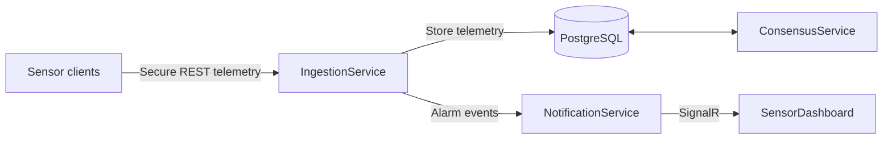

# Distributed Temperature Monitoring System

A distributed temperature-monitoring system built with **C# / .NET 8**, **PostgreSQL**, **Docker**, and **Kubernetes**. Simulated sensors securely transmit telemetry to an ingestion service, while background services monitor availability, calculate consensus values, identify anomalous readings, and deliver real-time alerts to an operator dashboard.

Developed as a team project for **Supervisory Control Systems Software** at the **Faculty of Technical Sciences, University of Novi Sad**.

## Features

- **Distributed sensor telemetry:** simulated sensors register dynamically and send temperature readings with message IDs, timestamps, and alert priorities.
- **Hybrid cryptography:** secure sensor messages use AES-GCM encryption, RSA-encrypted AES keys, and RSA digital signatures.
- **Replay protection:** incoming measurements are checked against sensor-specific message IDs and timestamps.
- **Rate limiting and quarantine:** a fixed-window limiter allows 10 measurement requests per second per sensor and temporarily blocks sensors that exceed the limit.
- **Fault tolerance:** a background worker detects inactive sensors and promotes eligible reserve sensors to maintain up to five active sensors.
- **Consensus and anomaly detection:** readings are evaluated in one-minute windows with a median-based approach to identify outliers and track sensor quality.
- **Real-time alarms:** prioritized temperature alerts are delivered to the operator dashboard through SignalR.
- **Operator dashboard:** an interactive console shows sensor status, incoming alarms, and consensus history.
- **Containerized infrastructure:** Docker Compose orchestrates the services; Kubernetes deployment manifests are also included.

## Architecture



| Component | Responsibility |
| --- | --- |
| **SensorClient** | Generates readings, registers sensors, signs and encrypts telemetry, and supports `normal`, `spam`, and `outlier` modes. |
| **IngestionService** | Receives telemetry, checks messages, manages sensors, stores measurements, and triggers alarms. |
| **ConsensusService** | Analyzes measurements over one-minute windows and updates sensor quality based on repeated outliers. |
| **NotificationService** | Broadcasts alarms to connected operator stations through ASP.NET Core SignalR. |
| **SensorDashboard** | Console operator station for live alarms, registered sensors, and historical consensus results. |
| **PostgreSQL** | Stores sensor registrations, measurements, and consensus results via Entity Framework Core. |

### Consensus and fault tolerance

Each minute, **ConsensusService** groups the previous minute's measurements by sensor and calculates an average reading for each eligible sensor. It compares these readings with the **median** and uses the median absolute deviation to identify outliers. At least **three sensors** must remain for a consensus result to be accepted.

Repeatedly excluded sensors accumulate a suspicion count. When it reaches **three**, the sensor is marked **`BAD`** and deactivated. Independently, **FaultToleranceWorker** detects sensors that stop reporting and promotes eligible reserve sensors when active slots become available.

### Secure telemetry and notifications

**SensorClient** creates secure payload envelopes using **AES-GCM**, RSA-OAEP encryption of session keys, and **RSA-SHA256 signatures**. IngestionService validates signed messages and checks timestamps and increasing message IDs to detect replayed or out-of-order telemetry. A per-sensor fixed-window rate limiter and temporary quarantine respond to excessive request rates.

Temperature alerts are forwarded from IngestionService to NotificationService, which distributes them to operator dashboards via **SignalR** using three alert priorities.

## Screenshots

These screenshots were captured from a running Docker Compose deployment. **Click an image for its full resolution.**

### Normal operation

**Operator overview** - registered sensors, activity, quality, blocked status, and an incoming alert.

[](docs/images/Screenshot%202026-10-27%20175648.png)

**Consensus history** - the temperature consensus for each minute, including the numbers of included and excluded sensors.

[](docs/images/Screenshot%202026-10-27%20180012.png)

<details>
<summary><b>More: sensor telemetry and SignalR alerts</b></summary>

**Sensor output** - registration, temperatures, message counters, and priorities:

[](docs/images/Screenshot%202026-10-27%20175402.png)

**Alerts** - notifications with different priority levels in the operator dashboard:

[](docs/images/Screenshot%202026-10-27%20175819.png)

</details>

### Spam / DoS protection

In **`spam` mode**, a sensor sends measurements at **50 ms intervals**. When it exceeds the fixed-window rate limit, the server responds with **429 Too Many Requests**, and the sensor can be placed in a temporary quarantine (**403 Forbidden**).

**Client-side behavior** - repeated rate-limit and quarantine messages, followed by retries:

[](docs/images/Screenshot%202026-10-27%20180701.png)

<details>
<summary><b>More: server-side detection and operator status</b></summary>

**IngestionService** - security warnings and automatic blocking/unblocking:

[](docs/images/Screenshot%202026-10-27%20180902.png)

**Operator dashboard** - the offending sensor appears as inactive and blocked:

[](docs/images/Screenshot%202026-10-27%20180720.png)

</details>

### Outlier detection and quality control

In **`outlier` mode**, a sensor deliberately generates unusually high temperatures. **ConsensusService** detects repeated deviations and eventually marks a persistently suspicious sensor **`BAD`**.

**Consensus processing** - the suspicion count reaches three and the sensor is flagged as bad:

[](docs/images/Screenshot%202026-10-27%20181432.png)

**Operator dashboard** - the detected sensor is shown with `BAD` quality and an inactive state:

[](docs/images/Screenshot%202026-10-27%20181507.png)

<details>
<summary><b>More: outlier sensor readings</b></summary>

**Outlier client** - intentionally abnormal temperature readings and later quarantine messages:

[](docs/images/Screenshot%202026-10-27%20181542.png)

</details>

## Running the project

### Requirements

- **Docker Desktop** (or Docker Engine with the Compose plugin)
- Git to clone the repository

### Start all services

Run these commands in the repository root:

```bash
git clone https://github.com/bane-31/SensorTelemetrySystem.git
cd SensorTelemetrySystem
docker compose up -d --build
```

Docker Compose starts **PostgreSQL**, **IngestionService**, **ConsensusService**, **NotificationService**, **SensorDashboard**, and **five simulated sensors**. IngestionService applies the Entity Framework Core database migrations during startup.

Check container status:

```bash
docker compose ps
```

### Use the operator dashboard

Attach to its interactive terminal:

```bash
docker attach sensor-operator-dashboard
```

| Option | Action |
| --- | --- |
| `1` | View registered sensors, activity, quality, and blocked status. |
| `2` | View historical consensus windows and included/excluded sensor counts. |
| `3` | Clear the terminal. |
| `4` | Exit the dashboard. |

Live SignalR alerts are printed to the dashboard console while it is connected. To **detach without stopping the container**, press **Ctrl+P**, then **Ctrl+Q**.

### Inspect logs

Run the relevant command in a terminal:

```bash
docker compose logs -f sensor-1
docker compose logs -f ingestion-service
docker compose logs -f consensus-service
```

Stop following a log with **Ctrl+C**.

## Testing the scenarios

### Normal telemetry

The default deployment launches five sensor clients in normal mode. Each dynamically registers, generates readings within its assigned temperature range, and sends encrypted telemetry. Use the operator dashboard to see incoming alarms and sensor status. After a few minutes, menu option `2` shows consensus history.

### Spam and automatic quarantine

Start an **additional sensor** in spam mode:

```bash
docker compose run --rm sensor-1 spam
```

Watch the client for `LIMIT`, `BLOCKED`, and `HIBERNATION` messages, and watch `ingestion-service` logs for the automatic DoS detection and quarantine events. Stop the additional client with **Ctrl+C** when finished.

### Outlier detection

Free one active slot and allow the inactivity monitor to recognize the stopped sensor (typically **10–20 seconds**):

```bash
docker compose stop sensor-5
```

Then start an **additional sensor** in outlier mode:

```bash
docker compose run --rm sensor-5 outlier
```

Use dashboard option `1` to confirm that the new sensor is **active**. Follow `consensus-service` logs over several one-minute windows to observe suspicious readings and quality changes. When finished, stop the additional client with **Ctrl+C** and restore the original:

```bash
docker compose start sensor-5
```

### Reserve sensor promotion

With five sensors active, launch a sixth client in normal mode:

```bash
docker compose run --rm sensor-1 normal
```

The new sensor is initially registered as a reserve. Stop an active sensor using `docker compose stop sensor-4`, then check IngestionService logs for inactivity detection and promotion of the eligible reserve. Stop the extra client and restore the original using `docker compose start sensor-4`.

### Stop the deployment

```bash
docker compose down
```

The named PostgreSQL volume remains available for subsequent runs unless explicitly removed.

## Technologies

| Area | Technology |
| --- | --- |
| Application services | C#, .NET 8, ASP.NET Core, `BackgroundService` |
| Real-time events | ASP.NET Core SignalR |
| Database and ORM | PostgreSQL 15, Entity Framework Core, Npgsql |
| Security mechanisms | AES-GCM, RSA encryption and signatures, replay checks, ASP.NET Core rate limiting |
| Deployment | Docker, Docker Compose, Kubernetes manifests |
| Communication | REST, JSON, shared DTOs |

## Repository structure

```text
.
├── docker-compose.yaml
├── k8s/                       # Kubernetes deployment and infrastructure manifests
├── src/
│   ├── ConsensusService/      # Consensus analysis and sensor quality
│   ├── IngestionService/      # REST API, persistence, security and fault tolerance
│   ├── NotificationService/   # SignalR alarm broadcasting
│   ├── SensorClient/          # Sensor simulation and test modes
│   ├── SensorDashboard/       # Interactive operator console
│   ├── SharedContracts/       # DTOs, enums and shared cryptography
│   └── SensorSystem.slnx
├── docs/
│   └── images/                # Screenshots of system operation
├── SECURITY.md
└── README.md
```

The `k8s/` directory includes deployment, service, PostgreSQL storage, and ingress manifests for Kubernetes-based deployment.

## Team

- **[Branislav Marković](https://github.com/bane-31)**
- **[Nikola Savić](https://github.com/nikolasa004)**
- **[Uroš Milinović](https://github.com/UrosMilinovic)**

Developed collaboratively at the **Faculty of Technical Sciences, University of Novi Sad**.
